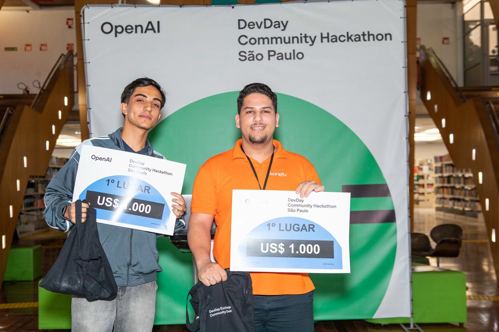
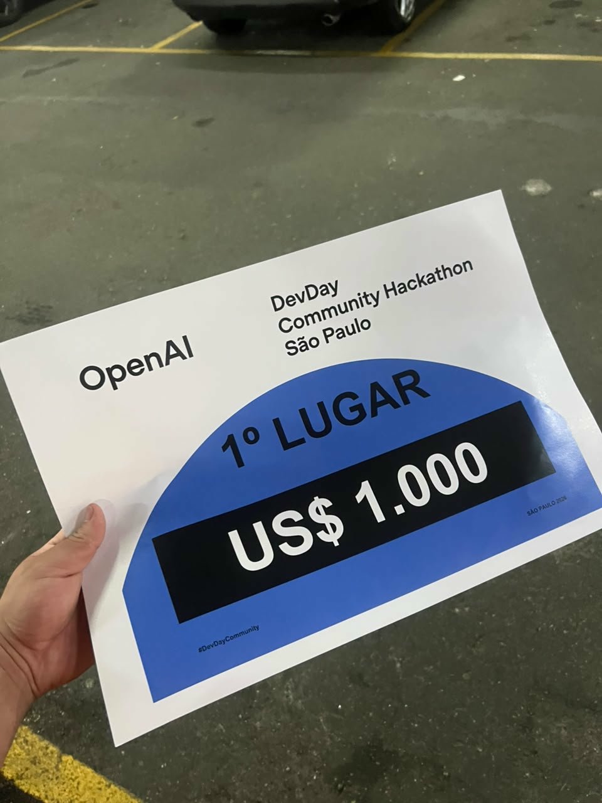

# Julio Akamine

### Especialista em Desenvolvimento com IA · Full Stack

Desenvolvedor na **[Kanglu](https://kanglu.com.br)** · 🏆 **1º lugar no OpenAI DevDay Community Hackathon São Paulo 2026**

📍 Bragança Paulista – SP

---

## Sobre mim

Construo produtos que colocam IA em produção: agentes, automações e aplicações full stack, do protótipo ao deploy. Na **Kanglu**, plataforma de rastreio e comunicação pós-compra para e-commerce, trabalho com integrações com Bling, Tiny, TikTok Shop e transportadoras como a Frenet.

Formado em Técnico em Informática para Internet pelo **Senac** e cursando graduação na área de software. Tenho background em design, o que me ajuda a entregar interfaces com boa experiência de uso.

---

## 🏆 1º lugar · OpenAI DevDay Community Hackathon São Paulo 2026

Em outubro de 2026 conquistei o **1º lugar (US$ 1.000)** no hackathon da comunidade OpenAI DevDay em São Paulo.

  
  &nbsp;
  

---

## O que eu faço

- **Desenvolvimento com IA:** produtos com LLMs (OpenAI e outros), agentes e pipelines de geração de conteúdo.
- **Automação:** atendimento automatizado via WhatsApp e fluxos que eliminam trabalho manual.
- **Full stack:** web e mobile com TypeScript, React, React Native, Next.js e Node.js, com deploy em Docker.

---

## Projetos em destaque

| Projeto | Descrição | Stack |
|---|---|---|
| **Cenora** *(privado)* | Estúdio local de criação de vídeos com IA: roteiro, narração, cenas, trilha e publicação. | IA · TypeScript |
| **Cotidiano Aberto** *(privado)* | Canal no YouTube com vídeos animados produzidos com IA. | IA · SVG · GSAP |
| [clip-mvp](https://github.com/JulioAkaminee/clip-mvp) | MVP local de cortes automáticos para YouTube/TikTok via OpenRouter. | IA · LLMs |
| [devday-hackathon](https://github.com/JulioAkaminee/devday-hackathon) | Projeto do OpenAI DevDay Community Hackathon SP 2026. | OpenAI |
| [viajados](https://github.com/JulioAkaminee/viajados) + [backend](https://github.com/JulioAkaminee/backendViajados) | App de viagens: busca de destinos, roteiros e dicas. | React Native · Node.js |
| [infobus](https://github.com/JulioAkaminee/infobus) | Rastreio de ônibus da SPTrans em tempo real com a API Olho Vivo. | JavaScript · API |
| [QuebradaLoungeV2](https://github.com/JulioAkaminee/QuebradaLoungeV2) | Loja online de adega. | Next.js · Node.js · MySQL |
| [ackto-nextjs-template](https://github.com/JulioAkaminee/ackto-nextjs-template) · [react](https://github.com/JulioAkaminee/ackto-react-template) · [portal](https://github.com/JulioAkaminee/ackto-portal-mini-store-template) | Templates de produção: Next 16 / Vite, React 19, Payload CMS 3. | TS · Tailwind · shadcn/ui |
| [dsh-plugin-system-monitor](https://github.com/JulioAkaminee/dsh-plugin-system-monitor) | Monitor de CPU, RAM e cotas de assinatura para o DeepSeek Harness. | Plugin |
| [flappy-bird-3d](https://github.com/JulioAkaminee/flappy-bird-3d) | Flappy Bird 3D jogável no navegador. | Web 3D |
| Sites para negócios locais | [Iron Fit](https://github.com/JulioAkaminee/iron-fit-braganca) · [Sabor de Bragança](https://github.com/JulioAkaminee/sabor-de-braganca) · [Construtora Vista](https://github.com/JulioAkaminee/construtora-vista) · [Pet Amigo](https://github.com/JulioAkaminee/pet-amigo) · [Essência Spa](https://github.com/JulioAkaminee/essencia-spa) | Landing pages |

---

## Stack

**IA & Automação**

**Linguagens & Front-end**

**Back-end & Dados**

**Infra & Ferramentas**

---

## GitHub

  
  

---

## Contato

- 💼 LinkedIn: [linkedin.com/in/julioakamine](https://www.linkedin.com/in/julioakamine/)
- 📧 Trabalho: [julio@kanglu.com.br](mailto:julio@kanglu.com.br)
- 📧 Pessoal: [juliooakamine@gmail.com](mailto:juliooakamine@gmail.com)
